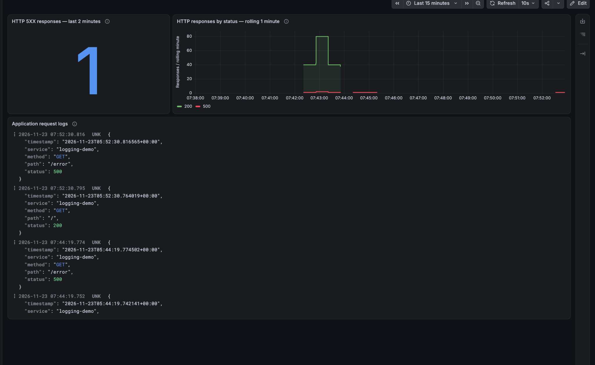
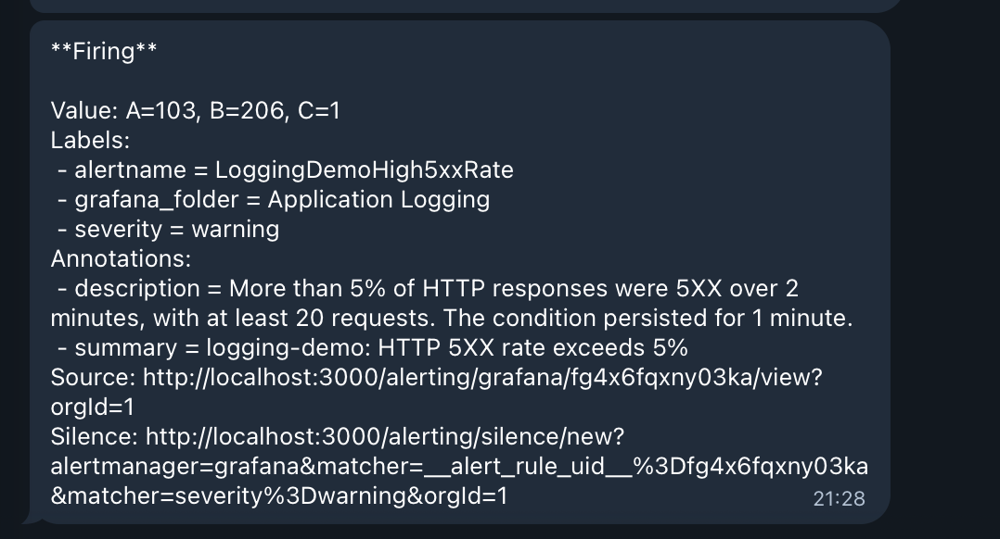

# Application Logging and Alerting

This lab adds application logging to the local Kubernetes cluster from Task 1. Alloy collects JSON request logs from a Python application and sends them to Loki. Grafana displays the logs and evaluates an alert rule. Telegram receives notifications when the rule fires and resolves.

## Tools and environment

The setup runs on a MacBook Air M1 with 8 GB RAM, using OrbStack and the existing single-node kind cluster `monitoring`. The kubectl context is `kind-monitoring`. Application logging components use the `logging-lab` namespace.

| Tool | Purpose and reason for choosing it |
|---|---|
| Python 3.13 | A small HTTP application with predictable success and error endpoints and structured JSON logs. |
| Grafana Alloy v1.13.0 | Collects Pod logs through the Kubernetes API without mounting node log directories. Discovery and permissions are restricted to the application namespace. |
| Loki 3.7.0 | Stores and queries logs. One monolithic instance with filesystem storage keeps the local deployment small. |
| Grafana | Reuses the instance from Task 1 for log exploration, dashboards, and alert evaluation. |
| Telegram | Delivers notifications to a real destination so the test covers notification delivery as well as rule evaluation. |

## Setup process

The `logging-demo` application exposes `/` with HTTP 200 and `/error` with HTTP 500. Each request writes a JSON line to stdout containing a timestamp, service name, method, path, and numeric status. Health probes are excluded from request logging.

From the repository root, deploy the application and logging components to the existing cluster:

```bash
kubectl --context kind-monitoring create namespace logging-lab \
  --dry-run=client -o yaml | kubectl --context kind-monitoring apply -f -

kubectl --context kind-monitoring -n logging-lab create configmap logging-demo-app \
  --from-file=app.py=logging/app/app.py \
  --dry-run=client -o yaml | kubectl --context kind-monitoring apply -f -

kubectl --context kind-monitoring apply -f logging/app/deployment.yaml

bash logging/install-stack.sh
```

Loki uses a 2 Gi PVC with the `standard` storage class, TSDB schema v13, and 24-hour retention. Physical deletion is asynchronous. Alloy discovers Pods with `app=logging-demo` and attaches namespace, application, Pod, and container labels. HTTP status is parsed from the JSON log body when querying.

In Grafana, the Loki data source points to:

```text
http://loki.logging-lab.svc.cluster.local:3100
```

The [dashboard JSON](../dashboards/Application-Logging.json) was imported and mapped to the existing `loki` data source. During import, its title was set to **Application Logs and HTTP Errors** to avoid a name conflict with the **Application Logging** folder. The dashboard is stored in that folder.

## Dashboard

| Panel | What it shows |
|---|---|
| HTTP 5XX responses — last 2 minutes | Recent server-error count. The count helps identify errors; the alert also checks their percentage, request volume, and duration. |
| HTTP responses by status — rolling 1 minute | Successful and failed responses over time, grouped by HTTP status. This helps locate the start of an incident and compare it with recovery. |
| Application request logs | Individual JSON request records for inspecting the paths and responses behind the counts. |



## Alert rule

The Grafana-managed rule `LoggingDemoHigh5xxRate` detects a sustained error spike. It uses two Loki instant queries and a Math expression.

**A — HTTP 5XX responses in the last two minutes:**

```logql
sum(
  count_over_time(
    {namespace="logging-lab",app="logging-demo"}
    | json
    | status >= 500
    | status < 600
    | __error__="" [2m]
  )
) or vector(0)
```

**B — all valid HTTP responses in the same window:**

```logql
sum(
  count_over_time(
    {namespace="logging-lab",app="logging-demo"}
    | json
    | status >= 100
    | status < 600
    | __error__="" [2m]
  )
) or vector(0)
```

**C — alert condition:**

```text
($B >= 20) && ($A > 0.05 * $B)
```

| Setting | Value |
|---|---|
| Error threshold | More than 5% of responses are 5XX |
| Minimum volume | At least 20 requests in two minutes |
| Evaluation interval | 30 seconds |
| Pending period | 1 minute |
| Keep firing for | None |
| Severity | warning |
| Contact point | telegram-devops |

The minimum volume avoids firing on a single failed request during low traffic. The pending period avoids firing on a brief spike. The [exported rule group](alerts/logging-alerts.yaml) is a Grafana provisioning file, not a Kubernetes manifest.

The Telegram contact point uses a bot token and chat ID entered locally in Grafana. Resolved notifications are enabled. The bot token is not included in the repository.

## Testing and results

Application and Grafana access use port-forwarding. Run each command in a separate terminal:

```bash
kubectl --context kind-monitoring -n logging-lab \
  port-forward svc/logging-demo 8081:80
```

```bash
kubectl --context kind-monitoring -n monitoring \
  port-forward svc/monitoring-grafana 3030:80
```

Basic requests returned HTTP 200 for `/` and HTTP 500 for `/error`. Both request records appeared in Grafana.

To simulate an incident, the following loop sent one successful and one failed request per iteration:

```bash
for i in {1..180}; do
  curl --max-time 3 -s -o /dev/null http://localhost:8081/
  curl --max-time 3 -s -o /dev/null http://localhost:8081/error
  sleep 1
done
```

The rule reached Firing, and Telegram received the notification with `A=103`, `B=206`, and `C=1`: 103 server errors out of 206 requests, or 50%.



After stopping error requests, successful requests continued:

```bash
for i in {1..300}; do
  curl --max-time 3 -s -o /dev/null http://localhost:8081/
  sleep 1
done
```

The rule returned to Normal and Telegram received a Resolved notification. Delivery occurred later than the state change; notification timing is separate from the rule evaluation interval.

## Challenges and fixes

Initially, Loki and Alloy Pods were Running, but Grafana showed no logs. Alloy reported failed pushes, while Loki returned `Ingester is shutting down`. Loki's WAL log identified the actual cause: disk usage had exceeded its write-throttling threshold.

The default threshold of 90% was temporarily raised to 97% for the local lab. Logging worked, but the disk later reached 100%, leaving about 24 MB free. Docker cleanup increased free space to 3.6 GB, and disk usage dropped to 92%. Loki and Alloy were restarted, and fresh HTTP 200 and 500 logs appeared on the dashboard again.

The lab currently retains the temporary 97% threshold. More disk headroom is needed before restoring the 90% default. Raising the threshold does not solve storage exhaustion.

Another configuration error was selecting Prometheus for the alert queries. Switching both queries to Loki resolved the parser errors for the LogQL pipeline operators.

## Access and limits

- [Open the dashboard](http://localhost:3030/d/course-application-logging)
- [Open the alert rule](http://localhost:3030/alerting/grafana/fg4x6fqxny03ka/view?orgId=1)

These links require the local cluster and Grafana port-forward to be running on the viewer's machine. The repository provides configuration, exports, and screenshots; a public live Grafana endpoint has not been deployed.

This is a local lab with one Loki replica. Its PVC depends on the kind node, and Alloy uses ephemeral storage. The configuration does not guarantee exactly-once log delivery across collector restarts.

The 5XX rule detects error spikes, not missing logs. Because its queries return zero when no matching records exist, Normal alone does not prove that ingestion is healthy. Fresh application requests were checked in Grafana to verify the complete pipeline.

## References

- [Collect Kubernetes logs with Alloy](https://grafana.com/docs/alloy/latest/collect/logs-in-kubernetes/)
- [Loki metric queries](https://grafana.com/docs/loki/latest/query/metric_queries/)
- [Grafana alerting with Loki](https://grafana.com/docs/grafana/latest/datasources/loki/alerting/)
- [Telegram integration](https://grafana.com/docs/grafana/latest/alerting/configure-notifications/manage-contact-points/integrations/configure-telegram/)
